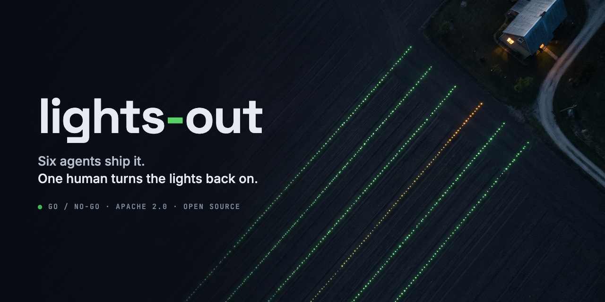

# lights-out



**The safety system for a dark factory of AI coding agents.** A lights-out factory runs in the dark because its safety systems are trusted. lights-out is that system, the guardrails for agents that write and ship code, with Claude Code, Gemini CLI or Codex at the keyboard.

**Autonomous agents take a ticket to production on a codebase you do not trust. Numeric gates decide, the ticket's perimeter holds, a failing canary rolls itself back, and one human approves the last step.**

It runs complete on your laptop: no account, no API key, no cloud.

| | |
|---|---|
| **Eight gates on every PR** | risk, secrets, weakened tests, dependencies, static analysis, tests, mutation, and test-proof: a test the change adds must fail on the base. Each prints one line, `GO` or `NO-GO` with the reason, and every threshold says where it comes from. A PR is judged by its base's policy, never its own: the principle GitHub applies to [`pull_request_target`](https://github.blog/changelog/2025-11-07-actions-pull_request_target-and-environment-branch-protections-changes/). GitHub takes the default branch, lights-out the PR's base commit, the same thing for a PR into the default branch. |
| **A perimeter per ticket** | the diff must stay inside the files the ticket declares, checked before a PR exists. A ticket whose files another open ticket holds waits at assign. |
| **The dev phase, visible** | a request becomes questions, answers and a spec, and the spec gate checks its criteria before an agent starts. The console shows every ticket on a kanban and on one timeline, from the request to the release, and says on each whose turn it is. |
| **Main stays green, without a queue** | a PR merges without a second judgment when nothing moved under its perimeter. Main is judged again after merging; a red main is bisected and the culprit reverted, and its ticket goes back to rework. |
| **A canary that rolls itself back** | one signed image per merge, 5% then 25% of real traffic, compared with stable on errors and p95 latency. A bad number rolls it back with nobody paged. |
| **One human gate** | the step to 100% waits for a person's GO. Silence never promotes. It has the semantics of Argo Rollouts' [indefinite pause](https://argo-rollouts.readthedocs.io/en/stable/features/canary/) and Flagger's [confirm-promotion webhook](https://docs.flagger.app/usage/webhooks), as the single human gate of a chain from ticket to production. |
| **Your model, your coding CLI** | Gemini, Claude or OpenAI, through `gemini-cli`, `claude-code` or `codex`, all behind the same guard ([coding harnesses](docs/reference.md#coding-harnesses)). |
| **Ops, too** | an alert becomes ranked hypotheses; an incident becomes a post mortem anchored to the audit chain, with each action item a ticket. |

What is proven and what is not yet is said plainly below, in [What is real and what is recorded](#what-is-real-and-what-is-recorded).

<p></p>
<p> </p>

The console (`./go console`): the kanban, a ticket's timeline from the request to the spec gate, and the overview. Every card, card's back and timeline says whose turn it is, a role's or yours, and when it is yours, the one thing to do: answer a question, go-for-launch, or decide after the last attempt; the overview lists those first, and the kanban's "Your turn only" keeps only those. A card carries its priority and feature as labels and badges for who has the ball, how long it has sat in its state and its rework attempts; it turns over, above the board, to its timeline in a few lines. It moves only when the tower moves its ticket. A network screen draws one ticket's agents as the harness governs them: the tower, the six roles, the workers with their harness and model, each gate lighting GO or NO-GO, the rework loop and the human gate, beside every attempt's gate lines and patch and the files by perimeter; `./go network` prints the same facts in text. It also has a specs screen, an editor for a new request that the spec gate checks as you type, a search over the project's ADRs from the project map, and a light and a dark theme. Rendered in CI over the logbook the console's tests build ([`fixtures/logbook/golden-1.3.json`](fixtures/logbook/golden-1.3.json)), which holds tickets in more states than one demo leaves; its model is a stub. After `./go demo`, the console shows ticket 0001 from the request to the rollback.

## Five ways in

Each step asks for one thing more than the one before, and gives back something you can see.

| Step | You need | You get |
|---|---|---|
| [0. Look](#0-look) | a browser | the site, a video tour, the board |
| [1. Gates on your repository](#1-gates-on-your-repository) | a pull request on GitHub, or podman or docker and git | the eight gates on every pull request from the GitHub Action, or on your last commit from the gates image (508 MB unpacked), without cloning lights-out |
| [2. The whole loop](#2-the-whole-loop-on-your-laptop) | the clone | `./go demo`: a ticket to a canary that rolls itself back, no key |
| [3. Agents on your repository](#3-agents-on-your-repository) | a model key | `./go init`, then tickets worked by real agents at L1 |
| [4. Toward production](#4-toward-production) | your code host, delivery and metrics | what exists today for L2 and L3, and what does not yet |

### 0. Look

[The site](https://nicolaguglielmi.github.io/lights-out/) explains it in five steps, with [a video tour](https://nicolaguglielmi.github.io/lights-out/media/overview.mp4), a clip per scenario and the console's screens. [The board](board/index.html) plays every scenario station by station: what each step does, which file does it and the line it prints.

### 1. Gates on your repository

Most people arrive from [the Action on the Marketplace](https://github.com/marketplace/actions/lights-out-gates). It posts the gates on every pull request as one check run, with one line per gate in its summary:

```yaml
permissions:
  contents: read
  checks: write
steps:
  - uses: actions/checkout@v7
    with:
      fetch-depth: 0
  - uses: nicolaguglielmi/lights-out@v0.3.1
```

The gates read a contract committed in your repository, `.lights-out/`: the test command, the mutation scope and baseline, the runners. A range is judged by the contract at its base, so a pull request cannot loosen what judges it. On a repository with none, the first check is NO-GO, because nothing may judge without a contract at the base ([ADR 0064](docs/adr/0064-the-first-run-drafts-the-contract.md)). After 0.3.0 that check also carries the fix: the Action drafts the contract from the base with `lights-out init`, puts its three small files in the check's summary for review, and attaches the whole draft to the run as an artifact, with the two commands that commit it. One commit, and the next check is judged. The 0.3.0 check prints the NO-GO line only; until the next release, draft the contract with the wrapper below.

`gates: test-proof` or `gates: test-integrity` runs one part. Those two are also standalone Actions, `nicolaguglielmi/lights-out/actions/test-proof@v0.3.1` and `nicolaguglielmi/lights-out/actions/test-integrity@v0.3.1`; each also has a repository of its own for its Marketplace page, `nicolaguglielmi/test-proof@v0.3.1` and `nicolaguglielmi/test-integrity@v0.3.1`. [The guide](docs/use-on-your-repo.md#the-action) has the details, and [the hook recipes](docs/use-on-your-repo.md#hook-recipes-for-coding-agents) run the gates before a coding agent commits.

On a pull request of a repository that is not lights-out ([the probe](https://github.com/nicolaguglielmi/lights-out-probe/pull/1)), each in a job of its own so that the first pull of the image is inside the time, the Action posted its check in 27 s, `test-proof` in 14 s and `test-integrity` in 25 s.

On your machine, the `lights-out` wrapper runs init and the gates from the gates image, `ghcr.io/nicolaguglielmi/lights-out-gates:0.3.1` (amd64 and arm64), inside your repository. You need podman or docker, and git. The image is 508 MB unpacked (amd64), with no cloud toolchain in it. `lights-out init` and `gates` took 48 s on a clean runner (`./go demo-package`). The full image, `ghcr.io/nicolaguglielmi/lights-out:0.3.1` (1,246 MB, 1.77 GB before gcloud and terraform left it), is for `triage` and `postmortem` only.

Version 0.3.0 was published on 2026-11-09 by the tag `v0.3.0`. From a clone, `./go package-gates` builds the same image, and `LIGHTS_OUT_IMAGE=localhost/lights-out-gates:dev` points the wrapper at it.

```sh
mkdir -p ~/.local/bin   # any directory on your PATH
curl -fsSL -o ~/.local/bin/lights-out https://raw.githubusercontent.com/nicolaguglielmi/lights-out/v0.3.1/lights-out
chmod +x ~/.local/bin/lights-out
```

```sh
cd ~/code/your-repo
lights-out doctor                  # engine, git, image, key: one line each
lights-out init                    # drafts .lights-out/ outside your repository
cp -R ~/.local/state/lights-out/your-repo/.lights-out/. .lights-out/
git add .lights-out && git commit -m "add lights-out contract"
lights-out gates                   # judges the last commit
lights-out test-proof              # only: the tests a change adds or changes must fail on its base
lights-out test-integrity          # only: no test weakened, the changed lines' mutants killed
```

Each command prints one line, named for itself. The images are signed keyless with Sigstore, through GitHub's OIDC token. There is no key to trust. To check one:

```sh
cosign verify ghcr.io/nicolaguglielmi/lights-out-gates:0.3.1 \
  --certificate-identity-regexp '^https://github.com/nicolaguglielmi/lights-out/.github/workflows/package.yml@refs/tags/v' \
  --certificate-oidc-issuer https://token.actions.githubusercontent.com
```

Tags are mutable. To pin the image, set `LIGHTS_OUT_IMAGE` to its digest (in the Action, the `image` input). `lights-out init` prints where the draft is. `LIGHTS_OUT_OUT` moves it. Keep the `/.` in the `cp` command: without it, `cp -R` into an existing `.lights-out/` nests the draft one level deeper. The wrapper mounts your repository read-only and never gives the image your engine's socket. `lights-out gates` judges the last commit, a range (`BASE=` and `HEAD=`), or what is staged (`STAGED=1`). It works with `TOOLCHAIN_IMAGE=workbench` only; a `compose:` or image form is judged from a clone with `./go gates`.

Without an engine, `lights-out-gates --light` runs the gates that need only git and Python in under a second, from a standard-library Python package on PyPI, `uvx lights-out-gates --light`, and its line names the four that need the image ([ADR 0061](docs/adr/0061-gates-without-a-container.md), [the light hook recipes](docs/use-on-your-repo.md#hook-recipes-for-coding-agents)). In Claude Code, the plugin brings the same gates as `/lights-out:gates`, a pre-commit hook and a read-only MCP server over the project map: `claude plugin marketplace add nicolaguglielmi/lights-out`, then `claude plugin install lights-out@lights-out` ([ADR 0069](docs/adr/0069-the-agents-own-toolbelt.md), [the plugin](docs/use-on-your-repo.md#the-claude-code-plugin)). Codex and Gemini CLI get the same two commands and the hook: [the Codex plugin](docs/use-on-your-repo.md#the-codex-plugin), [the Gemini CLI extension](docs/use-on-your-repo.md#the-gemini-cli-extension).

### 2. The whole loop on your laptop

**Install a container engine (once)**

| Your machine | Run |
|---|---|
| macOS | `brew install podman`<br>`podman machine init --cpus 4 --memory 6144`<br>`podman machine start` |
| Linux | `sudo apt-get install -y podman` (Debian, Ubuntu) or `sudo dnf install -y podman` (Fedora), then<br>`systemctl --user enable --now podman.socket` |
| Docker on Linux | start Docker and put `CONTAINER_ENGINE=docker` before every `./go` (what CI runs) |

**Clone and run**

```sh
git clone https://github.com/nicolaguglielmi/lights-out.git
cd lights-out
./go demo
```

**Watch**

- Ticket 0001 starts as a request. The spec gate checks its criteria.
- An agent turns it into a pull request inside the ticket's perimeter.
- Eight gates judge it: risk, secrets, weakened tests, dependencies, static analysis, tests, mutation, test-proof.
- It merges, main is judged again, and a signed release takes 5% of the traffic.
- Verify sees the errors and rolls the canary back on its own. No human involved.
- The run ends with `GO: demo`, then prints where to open the app, Gitea and Prometheus. `./go console` shows the ticket's whole timeline.

The first run downloads about 1.2 GB and builds the toolchain image (3–6 minutes), so expect 10–15 minutes. After that a run takes about 7 (measured: 434 s on a MacBook with podman). A 4 GiB podman machine runs one demo at a time.

**Shorter looks**

```sh
./go demo-triage     # an alert becomes ranked hypotheses, 3 seconds, nothing to start
./go demo-mainline   # main stays green without a queue: a moved perimeter goes to rework, a red main is bisected and the culprit reverted
./go incident        # build an incident document from the last release record: NAME= FROM= TO= [LOGS=<file>] [TICKET=<id>]
./go postmortem INCIDENT=<file>   # an incident document becomes a post mortem and tickets
./go demo-postmortem # replay the post mortem of the demo-rollback incident (needs a recording, see below)
./go record-postmortem PROFILE=l1 # record that answer once, with your Gemini key
./go up              # start the local plane (about 15 s once downloaded)
./go demo-rollback   # just the self-rollback, about a minute
./go board           # the pipeline explained, and live while the plane runs: localhost:8099
./go map             # the project map: tickets, files, tests, ADRs and pages of one commit, in .crew/map.sqlite
./go console         # the client's view: kanban (whose turn on every card), specs, a new-request editor, ADR search, each ticket's timeline from request to release, post mortems, thresholds, go-for-launch: localhost:8098
./go request TICKET=<id>   # start a ticket before the code: the product role asks or confirms, then the spec gate
./go answer TICKET=<id> ANSWER="<text>"   # answer its open question, then the product role again
./go down            # stop everything
```

**Ops without the plane**

An incident document holds the alerts, the release record, a log excerpt and the time window. `./go postmortem` turns it into a post mortem in `.crew/postmortem/<name>/`. Each timeline entry is anchored to an id the document holds (the release, a stage, a log line, an alert, and the PR or ticket when the tower released it), and core prints that evidence beside it. Every action item is filed as a ticket in `tickets/`. The ticket has no perimeter: a human adds one before `./go assign`. An anchored timeline is not a true one: the check stops invented releases and log lines, not a wrong story about real ones.

### 3. Agents on your repository

From a clone of lights-out:

```sh
./go init ~/code/your-repo   # attaches a clone of its HEAD and drafts the gates half of .lights-out/ in the clone
./go gates                   # judges the last commit: no plane, no key, no engine socket when the toolchain is the workbench
```

`./go init` never writes to your repository. It infers the stack from the files at the root (python or javascript), and writes `workload.env` with a provenance line over every value, plus `worker.md`, `policy.env` and the stack's runners. It measures `MUTATION_BASELINE` by running the mutation command over the whole scope. Its last line gives the stack, the draft's location and the baseline. Copy `.attached/.lights-out/` into your repository and commit it.

A toolchain gate's GO line says where it ran: `in workbench`, or the image or service the contract names. On the workbench, `./go gates` runs your repository's tests in lights-out's toolchain container, on this machine. Attach only a repository you would run here.

The plane comes next: attach, up, smoke, verify and rollback on your repository. It needs more of the contract: a compose file, a flag file, and smoke and load scripts.

- **Works:** the eight gates on the gates half alone. With the plane half, the canary and its rollback on your stable image, judged by the thresholds you set in `.lights-out/policy.env`. A change to `.lights-out/` never merges on its own.
- **Time:** `./go demo-init` proves init and gates in under 300 s on two small example repositories. Init measures the whole scope, so a large suite takes longer.
- **Needs a model key.** There are no recordings of your code, so on your repository the agents run at L1 only, and say so at L0: `GEMINI_API_KEY` for the coding roles (the free tier), or `AGENT_HARNESS=claude-code` with `ANTHROPIC_API_KEY`, or `AGENT_HARNESS=codex` with `OPENAI_API_KEY` (with `MODEL_PROVIDER` and `MODEL`; the ADK roles take the same keys). The dev-worker may spend up to 2.6M tokens per run (`roles/dev-worker/role.env`).

[The guide](docs/use-on-your-repo.md) says what `.lights-out/` holds, what each key says, what the plane needs, how to write tickets, the hook recipes for coding agents and the GitHub Action.

### 4. Toward production

What exists today, each opt-in, none yet run end to end on a repository of yours:

- **Pull requests on GitHub.** A merged change is built from your repository's own Containerfile, signed and released on the local plane. By default merges land on the plane's Gitea and you `git fetch` them back; with `CODE_HOST=github` and a token in `.env` the pull request lands on your GitHub repository instead ([ADR 0043](docs/adr/0043-github-code-host-and-attached-release.md)). There is no deploy to your production.
- **Delivery on Kubernetes.** If you already ship with Argo Rollouts, `DELIVERY=argo-rollouts` drives your Rollout with kubectl, stage by stage, instead of Envoy. It needs a traffic router and a Rollout with the steps [its README](adapters/argo-rollouts/README.md) lists. `./go argo-conformance` proves it with the same conformance suite, on a k3s node beside the plane; under podman that needs a rootful engine ([ADR 0051](docs/adr/0051-delivery-on-kubernetes-with-argo-rollouts.md)).
- **Your metrics.** `./go verify METRICS_URL=<any Prometheus-compatible endpoint> CANARY_VERSION=<v> STABLE_VERSION=<s>` judges your own canary with the unchanged `verify/slo.promql`. "Any Prometheus-compatible endpoint" means one that answers `/api/v1/query` with the OTel HTTP semconv histogram joined to `target_info{service_version}`. On other metrics the answer is NO-GO with "no data". An auth header goes in `.env` as `METRICS_AUTH_HEADER`.

Two commands say how far you are:

```sh
./go doctor --level l2        # what L2 still lacks, one line per item, then NO-GO or GO
./go production-readiness     # GO only when all four hold
```

`./go production-readiness` is GO only with all four:

- **Delivery:** the adapter in `DELIVERY` has a `rollback.sh` and passed its conformance suite here, for the adapter's files as they are now.
- **Metrics:** `METRICS=promql`, and `METRICS_URL` answers `count(target_info)`.
- **Secrets:** `.env` holds no value for a key ending `_KEY`, `_TOKEN`, `_SECRET` or `_PASSWORD`, nor for `METRICS_AUTH_HEADER`. `./go` passes those keys from your shell's environment, by name.
- **Human gate:** `GO_FOR_LAUNCH` is not preset, and the console runs with `CONSOLE_AUTH=proxy`, a `CONSOLE_IDENTITY_HEADER` and named `CONSOLE_LAUNCHERS`.

At L0 it is NO-GO by construction. [Toward production](docs/production.md) has every key behind these decisions, its default and where the default comes from.

## If something goes wrong

Run `./go doctor` first. It prints one line per item: the engine and whether it answers, the podman API socket, git, whether the workbench image is built, whether the plane's ports (3000, 5050, 8016, 9090, 9901 and `APP_PORT`; 8085 and 8086 too with the emulators) are free or held by the lights-out plane, and whether the key your profile needs is set in `.env` (the name, never the value). It ends with `GO: doctor` or `NO-GO: doctor — <items>`. `./go` also checks your engine before it builds anything and prints the command that fixes what is missing. The other cases:

| You see | Do this |
|---|---|
| A port is already in use | Put `APP_PORT=9000` in a file named `.env` for the app port. Ports 3000, 5050, 8016, 9090 and 9901 must be free (8085 and 8086 too with the emulators, ADR 0060). |
| `Cannot allocate memory`, or everything crawls | `podman machine stop`, `podman machine set --memory 6144`, `podman machine start` |
| `GO: demo … a first run: over the 900s budget, reported, not judged` | Everything worked; the first download and the toolchain build were slow. Your first run reports its time instead of failing on it. Later runs and CI are judged against the 900 s ([ADR 0013](docs/adr/0013-launchpad-canary-verify-rollback-at-l0.md), amendment 2026-11-04). |
| `NO-GO: demo — rollback reached, but … > 900s budget` | Everything worked, but a run after the first one took longer than 900 s. The engine is usually short of memory or CPU (see the row above), or other containers are running. `./go down`, then `./go demo` again. |
| `NO-GO: launchpad — …: cannot judge: …` | Prometheus could not answer a query, so the canary was rolled back without a verdict on it ([ADR 0066](docs/adr/0066-a-canary-that-cannot-be-judged.md)). `./go down`, then `./go demo` again; if it repeats, open an issue with the line. |
| Every `./go up` recreates every container (podman 4.9.3, the Ubuntu 24.04 package) | A bug of that podman's Docker-compatible API, not of your plane; the demo works with it ([ADR 0066](docs/adr/0066-a-canary-that-cannot-be-judged.md)). |
| Anything else | `./go down`, then `./go demo` again. Still stuck? Open an issue with the last 30 lines. |

## What is real and what is recorded

- **Real:** the gates, the signed build, the canary, the metrics, the rollback and the audit chain. Nothing in them is simulated.
- **Recorded:** without a key no model is called. The agents replay answers recorded once against the Gemini API (`fixtures/`), and `./go demo-rework`, `./go demo-network` and `./go demo-mainline` replay patches written by hand and say `model none`. With a key and `PROFILE=l1` the agents run live. The first live run on Claude (`claude-code` 2.1.311, `claude-sonnet-5-5`, ticket 0001, 2026-11-04) is the gates doing their job: the three ADK roles passed their evals, and the coding role's change was stopped by the mutation gate, 5 of 8 mutants killed on the changed lines, 0.625 under the 0.666 threshold. Nothing merged.
- **Before the ticket, at L0:** `./go demo` now starts ticket 0001 at `requested`. The product role has no recording for that request, so it is not consulted: the timeline says so, takes the criteria the ticket states, and the spec gate judges them for real ([ADR 0055](docs/adr/0055-the-dev-phase-visible-from-request-to-release.md) §3). A question and its answer replay only for the one request the role was recorded on (`./go ci` proves it), and under replay the answer's text is not compared with the recording: any answer replays the recorded criteria. Recording the product role on ticket 0001 takes `./go record-evals PROFILE=l1` and a key.
- **lights-out judges itself:** every push and pull request here runs the Action on its own change, with the contract in [`.lights-out/`](.lights-out/workload.env) and a judge built from the base ([ADR 0049](docs/adr/0049-lights-out-judges-itself.md)). Risk, secrets and deps cover the whole repository; the test gate is `make ci`, the thirty self-checks; SAST and mutation cover `core/` only, about 5% of the code, against a measured baseline of 0.39. The shell, three quarters of the code, has no mutation score: there is no mutation tool for POSIX sh to run.
- **Where shell is allowed:** on the host (`./go`), in adapter verbs, in the gate wrapper that prints the one line, and in thin entry points; logic goes to Python under `core/`, with unit tests from the ADRs. `ci/shell-boundary.sh` holds a `core/` shell file to 30 code lines and names the files over it as debt that can only shrink ([ADR 0052](docs/adr/0052-where-shell-is-allowed.md)).
- **The project map:** a SQLite file rebuilt from one commit at every merge, with no model ([ADR 0054](docs/adr/0054-the-project-map.md)). A merge that changes a path a page or an ADR cites files a docs ticket for the coding role, and `ci/docs-drift.sh` fails when a page cites a path, a `./go` command or a key that no longer exists. Putting the map's slice in the worker's brief is off by default (`MAP_BRIEF=off`) until the experiment on an outside repository measures whether it helps.
- **Not yet:** the GitHub Action is proven on one repository that is not lights-out, [a small probe](https://github.com/nicolaguglielmi/lights-out-probe/pull/1), with the image built in the job, not pulled; nothing is proven yet on a codebase that was not written for lights-out; the coding harnesses' network stays open, because each must reach its provider. For plane commands `./go` hands its toolchain container your engine's socket, which means full control of the engine: run it where that is acceptable. The cloud track and the experimental harness are in [the reference](docs/reference.md#the-cloud-track).

Every item, level by level: [what is real and what is recorded, in full](docs/reference.md#what-is-real-and-what-is-recorded).

## Next

- [The tutorial: the demo read stage by stage, then your own repository](docs/tutorial.md)
- [How it works, every command, every level, the coding harnesses](docs/reference.md)
- [Architecture](docs/ARCHITECTURE.md) and [decisions](docs/adr/)
- [Contributing](CONTRIBUTING.md) and [roadmap](ROADMAP.md)

## License

Apache License 2.0. See [LICENSE](LICENSE) and [NOTICE](NOTICE).